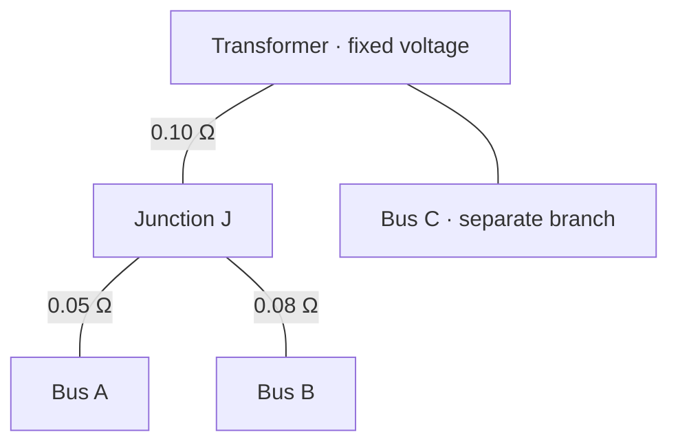

# Transfer impedance

**Transfer impedance** tells you how much the voltage at one bus changes per amp of current injected at another bus, with the other current injections held fixed.

$$Z_{BA}=\frac{\Delta\underline V_B}{\Delta\underline I_A}
\qquad [\Omega]$$
The subscripts mean measure voltage at B, change current at A.

> In simple terms, the transfer impedance from B to A (or A to B) is just the total impedance between the root to the parent's node (bus) of both node A and B.

For example, a current increase at bus A can lower the voltage at bus B because both buses are supplied through the same upstream line. The extra current increases the voltage drop on that shared line.

Use a single-phase, resistive model. Suppose A draws 10 A more, with all other bus currents held fixed.
- Transformer → J carries the extra 10 A, so J’s voltage falls by $0.10\times10=1.0\ \mathrm V$.
- J → A also carries the extra 10 A, so A falls by another $0.05\times10=0.5\ \mathrm V$, for a total of 1.5 V.
- J → B carries the same current as before, so its voltage drop stays the same. Its upstream end is now 1.0 V lower, so B also falls by 1.0 V.
- Bus C stays at the same voltage. Its path shares no line segments with A’s, and the transformer voltage is fixed.
So the transfer impedance from A to B is $0.10\ \Omega$, the impedance of the path from the transformer to the fork. In general, with current draw defined as positive,

$$\Delta \underline V_B
=
-\underbrace{\left(\sum_{e\in P_A\cap P_B} Z_e\right)}_{\text{transfer impedance from A to B}}
\Delta \underline I_A,$$

where $P_A$ and $P_B$ are the paths from the transformer to each bus.
